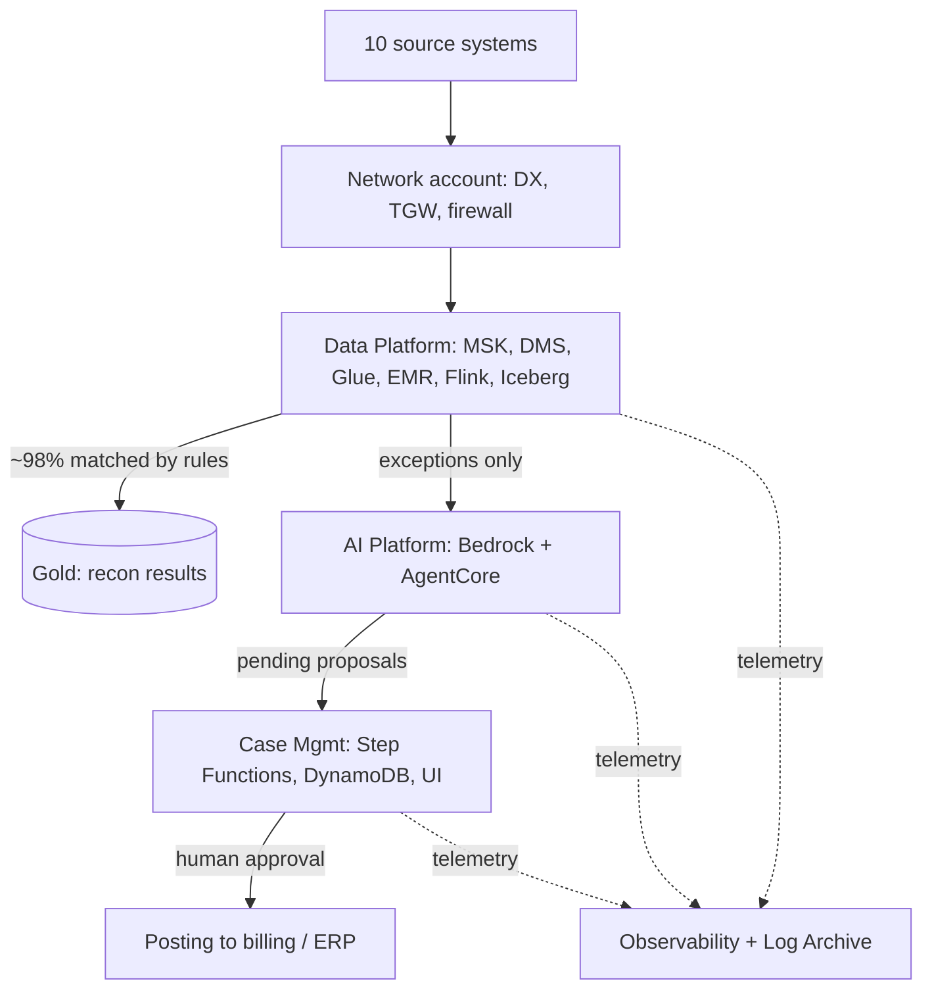
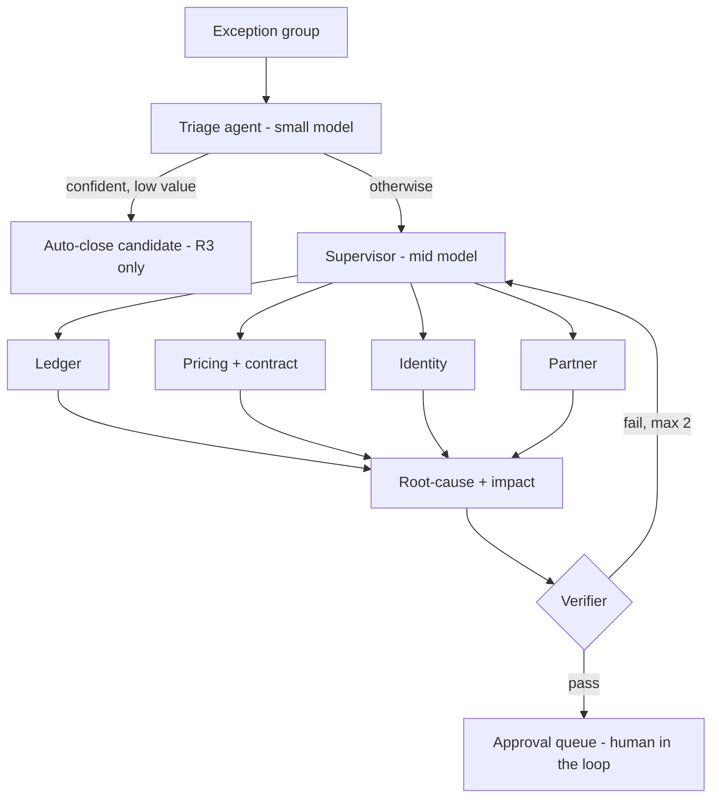

# Revenue Assurance AI on Amazon Bedrock

Reconcile **4 million transactions a day** across **10 billing and data systems**, find revenue leakage, and explain every break with evidence, using a deterministic reconciliation engine plus a multi-agent AI tier on Amazon Bedrock and AgentCore. The project is delivered with an **agentic SDLC** in Claude Code.

> Design principle: **rules first, AI for exceptions.** About 98% of records are matched by deterministic rules. Bedrock agents investigate only the breaks, propose fixes, and a human approves every adjustment until the evidence earns more autonomy.

## At a glance

| | |
| --- | --- |
| Volume | 4M business transactions/day, ~16M source records/day, 5x bill-run peaks |
| Sources | S1 mediation, S2 rating, S3/S4 billing, S5 CRM, S6 orders, S7 catalog, S8 payments, S9 ERP, S10 partner settlement |
| Controls | C1-C9 across the revenue chain (usage, rating, billing, provisioning, contracts, cash, ledger, partners, migration) |
| AI tier | Triage, supervisor, 4 specialists, root-cause, verifier on AgentCore Runtime; Bedrock Knowledge Bases; Guardrails |
| Delivery | 8 aSDLC phases, 7 gates, ~28 weeks to production |
| Website | [`website/index.html`](website/index.html), deployed by GitHub Pages |

## The product: run it now

`src/ra` is a working product, not a diagram. It runs on a laptop with no cloud account.

```bash
pip install -e ".[dev]"
ra seed                      # demo users, one per role; prints a generated password
ra run --period 2026-10      # reconcile ten synthetic sources, triage, investigate
ra serve                     # console, API, MCP and A2A at http://localhost:8080
```

| Capability | What you get | Docs |
| --- | --- | --- |
| Authentication | OIDC bearer tokens (Cognito, Entra ID, Okta) or a built-in provider with lockout and rate limits | [security](docs/product/security.md) |
| Authorization | Roles, business-unit scope, approval limits, four-eyes, human-only approval | [security](docs/product/security.md) |
| Reconciliation | 9 deterministic controls over 10 sources | [product guide](docs/product/README.md) |
| Agents | Triage, skill-driven investigation, independent verifier; nothing posts without a person | [agents](docs/product/agents-tools-skills.md) |
| Skills | 8 investigation procedures in `skills/`, loaded per case | [skills](skills/README.md) |
| Tools | 13 tools, one write tool (pending proposals only) | [tools](docs/product/agents-tools-skills.md) |
| MCP | The same tools over streamable HTTP and stdio | [MCP and A2A](docs/product/mcp-a2a.md) |
| A2A | Calls partner settlement agents; serves three skills to other agents | [MCP and A2A](docs/product/mcp-a2a.md) |
| Plug-ins | ERP journal, Jira, ServiceNow, Slack, signed webhook, CSV source, example Teams package | [plug-ins](plugins/README.md) |
| Auditing | Hash-chained, tamper-evident trail with before and after values | [auditing](docs/product/auditing.md) |
| Observability | OpenTelemetry traces, Prometheus metrics and alerts, JSON logs | [observability](docs/product/observability.md) |
| Reporting | Before/after: manual baseline vs product, and billed amount per adjustment | [reporting](docs/product/reporting.md) |

Stand-ins to replace before production: synthetic data, the offline rule-based reasoner
(Bedrock is one setting away but untested here), the mock partner agent, SQLite, and dry-run
connectors. See [what is real and what is a stand-in](docs/product/README.md#what-is-real-and-what-is-a-stand-in).

## Architecture





Full design: [`docs/architecture/`](docs/architecture/).

## The agentic SDLC

| Phase | Weeks | AI drafts | People decide | Gate |
| --- | --- | --- | --- | --- |
| [0 Inception](docs/asdlc/00-inception.md) | 1-2 | Intent, KPI tree, risk tier, spike | Scope, autonomy ceiling, funding | G0 |
| [1 Discovery](docs/asdlc/01-discovery.md) | 2-5 | Stories, controls, taxonomy | Accept in mob sessions | G1 |
| [2 Data readiness](docs/asdlc/02-data-readiness.md) | 3-10 | Profiles, contracts, pre-labels | Confirm labels, sign contracts | G2 |
| [3 Architecture](docs/asdlc/03-architecture.md) | 4-7 | ADR options, agent cards, specs | Accept ADRs, eval thresholds | G3 |
| [4 Construction](docs/asdlc/04-construction.md) | 6-24 | Code in bolts | Review and merge | G4 |
| [5 Evaluation](docs/asdlc/05-evaluation.md) | 8-26 | Evals, red-team cases | Sign validation pack | G5 |
| [6 Release](docs/asdlc/06-release.md) | 24-32 | Notes, SOPs, digests | Raise autonomy per class | G6 |
| [7 Operations](docs/asdlc/07-operations.md) | 28+ | Drift, audits, cost reports | Improve, upgrade, audit | Quarterly |

Read [`docs/asdlc/anti-patterns.md`](docs/asdlc/anti-patterns.md) at every gate.

## Repository map

```text
.
├── CLAUDE.md                 # project context for Claude Code (phase, rules)
├── .claude/                  # settings, hooks, subagents, skills
├── .github/                  # CI, eval gate, Pages deploy, templates, CODEOWNERS
├── docs/                     # architecture, aSDLC playbooks, ADRs, steering, templates
├── specs/                    # one spec folder per unit of work (U1-U7)
├── features/                 # Gherkin acceptance scenarios
├── data/                     # taxonomy, data contracts, control specs, mappings
├── src/ra/                   # the product: api, auth, recon, agents, tools, mcp, a2a, plugins, audit, obs, reporting
├── skills/                   # runtime agent skills (SKILL.md per investigation procedure)
├── plugins/                  # plug-in guide and an example third-party plug-in package
├── deploy/                   # observability stack config (collector, Prometheus, alerts, Grafana)
├── prompts/                  # prompt templates (synced to Bedrock Prompt Management)
├── config/                   # routing table and HITL thresholds per environment
├── evals/                    # eval harness, suites, dataset manifests, fault library
├── infra/                    # IaC (CDK or Terraform) by account and environment
├── tests/                    # unit and end-to-end tests (37)
└── website/                  # project website (GitHub Pages)
```

## Getting started

```bash
git clone https://github.com/AgenticForze/AI-Regenesis-RevAssurance.git
cd AI-Regenesis-RevAssurance
python -m venv .venv && source .venv/bin/activate
pip install -e ".[dev]"
make test          # 37 tests: product end to end, plus the Claude Code hooks
make eval-quick    # placeholder eval suite (wire to Bedrock in Phase 4)
claude             # start Claude Code with the project context
```

Claude Code picks up `CLAUDE.md`, `.claude/settings.json`, the subagents in `.claude/agents/` and the skills in `.claude/skills/` (`/intent`, `/bolt`, `/pr`, `/eval`, `/adr`, ...).

## Status

Version 0.2.0 is a **working reference product** plus the delivery playbook. The product runs end to end on synthetic data with an offline reasoner; the production-scale data plane (Spark, Flink, AgentCore) is described in `docs/architecture/` and is not built here. Volumes, thresholds, prices and the before-side of the report are planning assumptions to replace with your own baseline.

## Contributing and security

See [CONTRIBUTING.md](CONTRIBUTING.md) and [SECURITY.md](SECURITY.md). Choose and add a `LICENSE` before publishing the repository.
