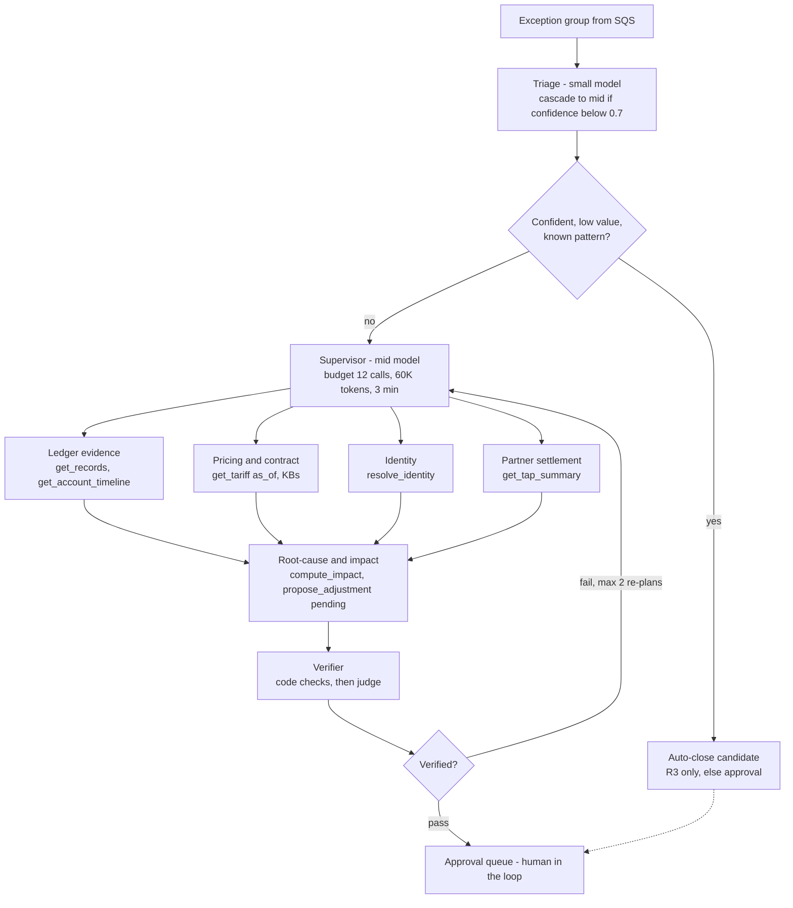

# Agent graph

| Agent | Tier | Tools (allow-list) | Output |
| --- | --- | --- | --- |
| Triage | Small | search_cases, get_tariff | root cause, action, confidence, missing info |
| Supervisor | Mid | dispatch, get_budget | plan of 2-5 steps |
| Ledger evidence | Small/Mid | get_records, get_account_timeline, compare_rated_vs_billed | evidence table |
| Pricing and contract | Mid | get_tariff(as_of), search_contracts | applicable price/discount + citations |
| Identity | Small | resolve_identity, get_crm_account | mapping verdict |
| Partner settlement | Mid | get_tap_summary, search_contracts | variance explanation |
| Root-cause and impact | Mid (frontier top 1%) | compute_impact, propose_adjustment | root cause, action, explanation |
| Verifier | Mid, other prompt/model | get_records, compute_impact | pass/fail + reasons |

Design cards: src/ra/agents/cards/. Tool contracts: src/ra/tools/specs/.
