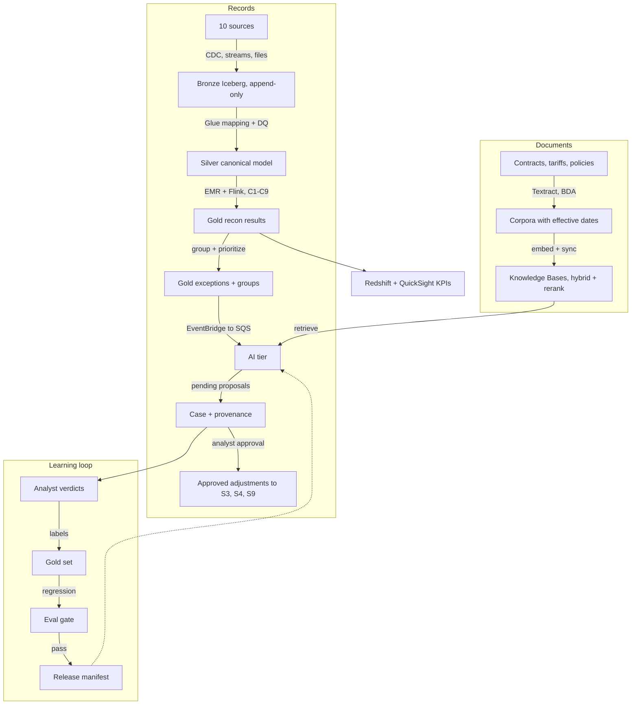

# Data flow

Lineage: OpenLineage events from Glue, EMR and Flink to SageMaker Unified Studio / DataZone;
Iceberg snapshot IDs are stored in every provenance record so any decision can be replayed.
