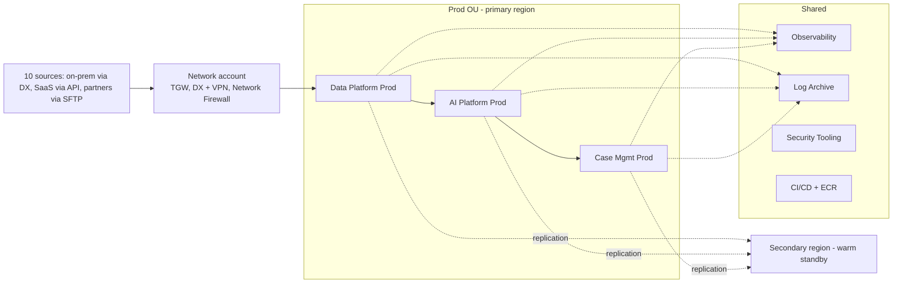

# Deployment architecture

| Account | Purpose |
| --- | --- |
| Management | Organizations, SCPs, billing only |
| Log Archive | CloudTrail, Config, invocation logs, evidence with Object Lock |
| Security Tooling | GuardDuty, Security Hub, Inspector, Macie, Access Analyzer |
| Network | Transit Gateway, Direct Connect, firewall, Route 53 Resolver, endpoints |
| Shared Services | Pipelines, ECR (signed images), AppConfig, IaC state |
| Observability | OAM sink, Managed Grafana and Prometheus, alarms |
| Data / AI / Case Prod | Workloads, one account per domain |
| Stage, Test, Dev | Same IaC; masked or synthetic data only |

**Network**: no internet route from workloads; interface endpoints for Bedrock, AgentCore, S3,
DynamoDB, STS, KMS, Logs, X-Ray and others; egress only through an allow-listed firewall.

**CI/CD**: PR -> build (SBOM, sign) -> Dev -> Test (regression evals = eval gate) -> Stage
(full gold, 5x replay, red-team) -> approval -> prod canary (AppConfig, aliases) -> 100%.

**Release manifest**: one immutable JSON per release referencing agent image digests, prompt
versions, routing, guardrail, KB index, thresholds, eval report and gold-set version
(docs/templates/release-manifest.json).
