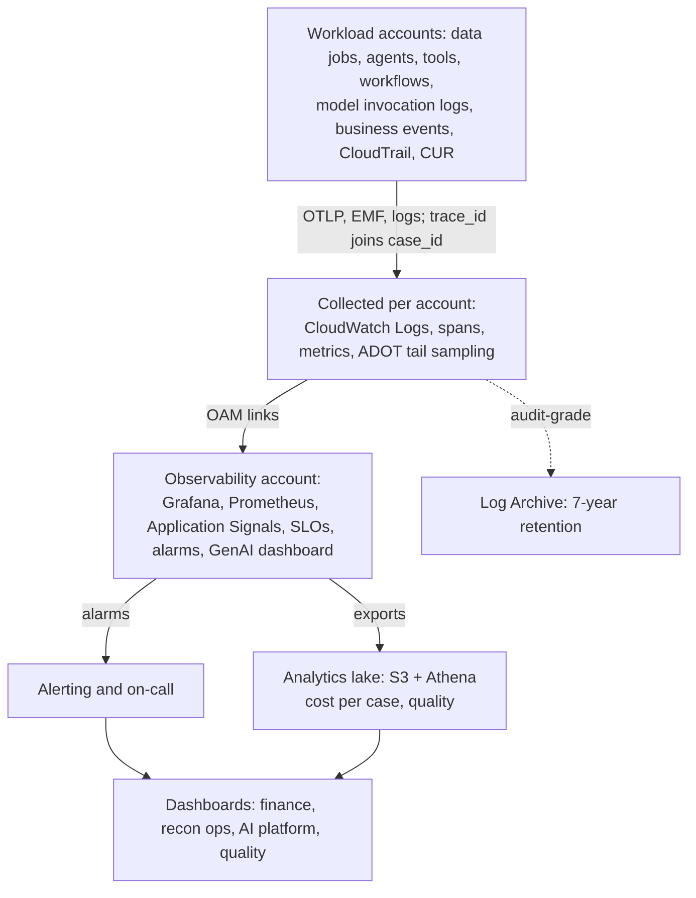

# Observability

## LLM span attributes
`gen_ai.system`, `gen_ai.request.model`, `gen_ai.usage.input_tokens`, `gen_ai.usage.output_tokens`,
`ra.cache_read_tokens`, `ra.cost_usd`, `ra.case_id`, `ra.agent`, `ra.step`, `ra.prompt_version`,
`ra.release`, `ra.guardrail_action`, `ra.confidence`, `ra.verifier_result`. Prompt content goes to
invocation logs (access-controlled), never to span attributes.

## SLOs
| SLO | Target |
| --- | --- |
| Feed freshness | 99% of feeds within SLA per day |
| Bill-run recon | Complete within 2 h of cycle close |
| Intraday detection | p95 < 5 min |
| Triage completion | 99% within 4 h of cycle close |
| Agent step latency | p95 < 20 s |
| Analyst assistant | p95 first token < 3 s; full answer < 8 s |
| Auto-close precision | >= 99% on weekly audit |
