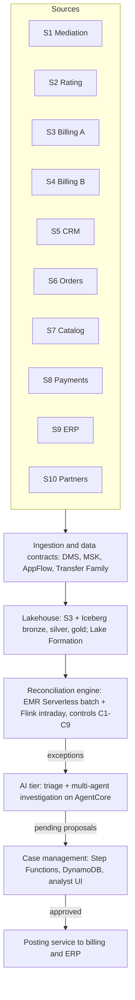

# Architecture overview

The system keeps the language model off the hot path: a deterministic reconciliation engine
matches ~98% of 16M source records a day; only exceptions reach the AI tier on Amazon Bedrock.

## Request paths

| Path | Trigger | Latency target | Bedrock usage |
| --- | --- | --- | --- |
| Bill-run batch | Cycle close | Recon < 2 h; triage 99% < 4 h | Batch inference for triage; agents for top groups |
| Intraday | Usage and payment events | High-value breaks < 5 min | On-demand triage |
| Analyst assistant | Question in UI | p95 first token < 3 s | Supervisor + KBs + text-to-SQL |

## Scale assumptions (replace with your baseline)

| Quantity | Value |
| --- | --- |
| Business transactions | 4,000,000/day (~46 TPS average, ~230 TPS peak) |
| Source records | ~16M/day |
| Exceptions to AI triage | ~80K/day (1-3% break rate) |
| Agent investigations | ~12K/day |
| Model spend (illustrative list prices) | ~$1.8K/day vs ~$36K/day if a mid model read every transaction |

## Model tiers

| Task | Tier | Notes |
| --- | --- | --- |
| Triage, extraction, query rewrite, memory summaries | Small (Haiku-class, Nova 2 Lite) | High volume, cached prefix, batch where possible |
| Supervisor, specialists, explanations | Mid (Sonnet-class) | Multi-step tool use |
| Top ~1% by value, verifier disagreement | Frontier (Opus-class) | Value-based escalation |
| Judge (evals) | Different family or stronger model | Calibrated against analysts |
| Embeddings, rerank | Titan/Cohere/Nova embeddings; Amazon or Cohere Rerank | Chosen by retrieval-gold recall |

Pin exact model versions per region; upgrades follow docs/asdlc/07-operations.md.
