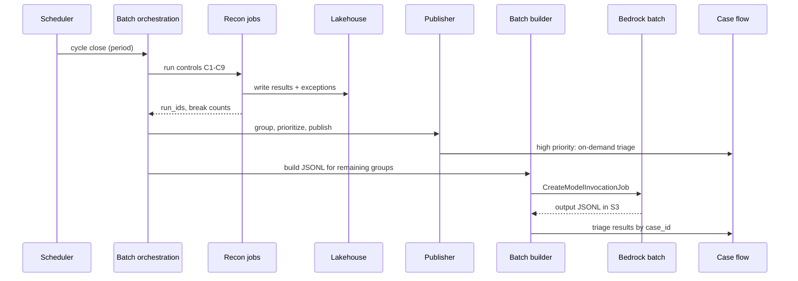
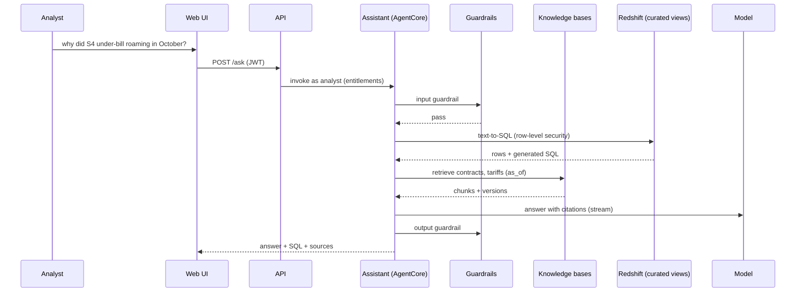

# Sequence diagrams

## One exception group, end to end

```mermaid
sequenceDiagram
  participant DP as Data platform
  participant EB as Event bus
  participant CF as Case flow (Step Functions)
  participant AG as Agents (AgentCore)
  participant GW as Gateway tools
  participant BR as Bedrock (models, KB)
  participant CS as Case store
  participant AN as Analyst
  DP->>EB: exception group (group_key)
  EB->>CF: start case (case_id, traceparent)
  CF->>CS: create case, provenance v0
  CF->>AG: invoke triage (session = case_id)
  AG->>BR: triage (cached prefix + group)
  BR-->>AG: root cause, confidence 0.62
  AG->>AG: confidence below 0.7: cascade, supervisor plans
  AG->>GW: get_records, get_tariff(as_of)
  GW->>DP: read gold and silver (read-only role)
  DP-->>GW: rows + record_uids
  GW-->>AG: typed evidence
  AG->>BR: KB retrieve + rerank; root-cause call
  BR-->>AG: proposal + chunk citations
  AG->>GW: compute_impact, propose_adjustment
  GW->>CS: pending proposal (idempotency key)
  AG->>BR: verifier: code checks + judge
  BR-->>AG: pass
  AG-->>CF: proposal_id, verified
  CF->>AN: approval task (task token)
  AN->>CF: approve (user, timestamp)
  CF->>CS: lock provenance; trigger posting
```

## Bill run with batch triage



## Analyst assistant question


