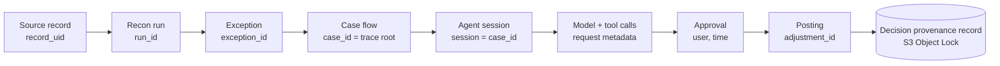

# Traceability

Any posted adjustment can be walked back to the source records, rules, retrieved documents,
model calls, versions and approver that produced it.

| ID | Format | Carried in |
| --- | --- | --- |
| record_uid | sha256(source_id + natural_key + version) | Iceberg rows, exception records |
| run_id | {control}-{period}-{engine_version}-{ts} | Recon results, exception event |
| exception_id | EX-{date}-{control}-{seq} | Event payload and attributes |
| case_id | CASE-{exception_group_id} | Step Functions input, AgentCore session, span baggage, Bedrock request metadata |
| trace_id | W3C, root at case creation | All spans |
| release | release manifest ID | Case record, span attribute |
| adjustment_id | ADJ-{case_id}-{n} | ERP/billing call (idempotency key) |

Provenance record example: docs/templates/provenance-record.json.
