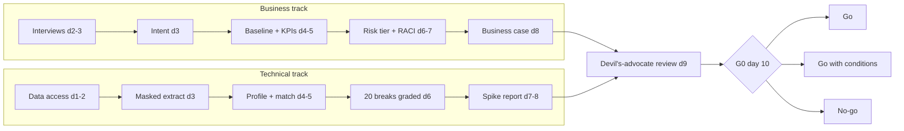

# Phase 0 - Inception (weeks 1-2)

**Goal**: a signed intent, measured baseline, AI risk tier, feasibility result and business case. Gate **G0**.

## Claude Code
- Skills: `/intent`, `/baseline`, `/kpi-tree`, `/risk-classify`, `/raci`, `/business-case`
- Subagents: `data-profiler`, `break-explainer`, `devils-advocate`
- Hooks: PII guard before writes; change log after writes

## Feasibility spike success criteria
| Criterion | Pass if |
| --- | --- |
| Match quality | >= 90% of S2 records matched after key normalization |
| Real breaks | >= 5 confirmed by analysts |
| Explanation quality | >= 14 of 20 rated correct and useful |
| Groundedness | 0 invented numbers |
| Unit cost | Within the design's cost envelope |

## G0 checklist
- [ ] Intent approved; baseline spot-checked; KPI tree with targets and owners
- [ ] AI risk tier agreed; release-1 autonomy = recommend-only
- [ ] Data access committed for >= 3 sources; spike criteria met or conditions written
- [ ] Business case with three scenarios; devil's-advocate blockers closed
