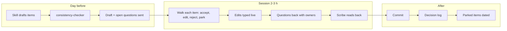

# Phase 1 - Discovery and elaboration (weeks 2-5)

**Goal**: validated requirements baseline: revenue chain, controls C1-C9, taxonomy, stories with Gherkin examples, NFRs, units of work. Gate **G1**.

## Six mob sessions
| Session | Decides |
| --- | --- |
| M1 Revenue chain | System roles, hops that can leak |
| M2 Controls | C1-C9 keys, tolerances, cutoffs |
| M3 Taxonomy | Root causes, actions, severity bands (data/taxonomy.yaml) |
| M4 Analyst stories | Triage, investigation, case work, assistant |
| M5 Finance, audit, NFRs | Approvals, evidence, NFRs, retention |
| M6 Units of work | U1-U7 with owners and dependencies |

## Traceability
Goal -> KPI -> REQ -> feature file -> unit + task -> commit/PR -> tests + evals -> release manifest.

## G1 checklist
- [ ] Revenue chain accepted; every hop covered by a control
- [ ] C1-C9 agreed or TBC with dated owners; taxonomy frozen
- [ ] Must-have stories with >= 2 scenarios; NFRs numbered with verification
- [ ] Units with owners; traceability matrix complete
