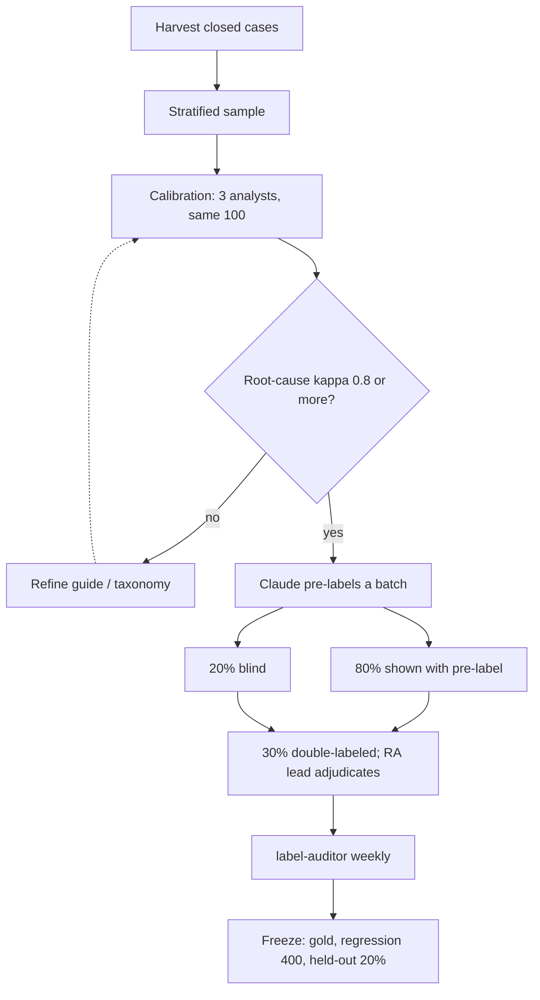

# Phase 2 - Data readiness (weeks 3-10)

**Goal**: trustworthy, labeled data before anything is built on it. Gate **G2**.

## Workstreams
| Stream | Steps |
| --- | --- |
| Source data | Access, masking (HMAC tokens), profiling, contracts (data/contracts/), mapping, identity map >= 98% |
| Gold and test data | Harvest, sampling plan, calibration, labeling, freeze; fault library (evals/faults/) |
| RAG corpora | Inventory, convert with effective dates, 300+ retrieval questions, verified answers, baseline |

## Rules
- Claude reads masked samples only; pre-labels are never gold until confirmed.
- Models generate text only; ledger numbers come from the deterministic fault library.

## G2 checklist
- [ ] 10 sources accessible and masked (Macie clean); contracts signed; DQ passing
- [ ] Identity coverage >= 98%; mapping specs with tests
- [ ] Gold >= 3,500 cases, >= 50 per root cause, kappa targets met; regression and held-out frozen
- [ ] Fault library and retrieval gold set ready; retrieval baseline measured
