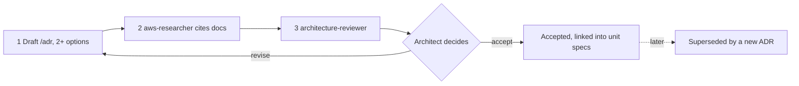

# Phase 3 - Architecture and agent design (weeks 4-7)

**Goal**: decisions that are expensive to change, plus specs coding agents can implement. Gate **G3**.

## Outputs
- ADR-001..016 (docs/adr/), agent design cards (src/ra/agents/cards/), tool contracts (src/ra/tools/specs/)
- Eval plan with thresholds per suite (docs/asdlc/05-evaluation.md), threat model, model risk draft
- Capacity and quota plan (request Bedrock and AgentCore quotas in week 4)
- Unit specs specs/U1..U7 (requirements, design, tasks <= 2 days, tests) and repo scaffold
- Architecture views: docs/architecture/

## G3 checklist
- [ ] ADRs accepted or deferred with owners; agent cards reviewed; only propose_adjustment writes
- [ ] Eval plan signed; threat model approved; quotas filed
- [ ] Unit specs complete; scaffold merged; CI green
