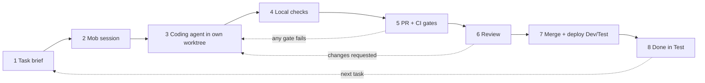

# Phase 4 - Construction in bolts (weeks 6-24)

**Goal**: build U1-U7 from specs in bolts; deterministic layers first, AI layers once data and evals exist. Gate **G4**.

## Plan
| Weeks | Units |
| --- | --- |
| 6-24 | U7 Platform + observability |
| 6-12 | U1 Ingestion + canonical model |
| 9-16 | U2 Recon engine (shadow vs current process) |
| 9-15 | U3 Case management |
| 12-18 | U4 Triage + RAG (after G2) |
| 16-22 | U5 Investigation agents |
| 20-24 | U6 Analyst assistant; hardening |

## PR gates
Unit tests + coverage, lint, SAST, IaC policy, contract tests, acceptance tests; data units add the
fault suite; AI units add the eval subset (no metric -1 pt, no safety failure, cost <= +10%).
AI reviewers advise; a human code owner approves.

## Parallel agents safely
One task, one branch, one worktree; no shared files; personal dev account with masked data and a
Bedrock budget alarm; 2-3 agents per reviewer; daily rebase.

## G4 checklist
- [ ] All unit tasks done or deferred; feeds landing in Stage; recon shadow cycle explained
- [ ] Provenance and posting (dry-run) working; audit drill < 10 min
- [ ] AI units meet regression targets per slice; sequences run end to end in Stage
