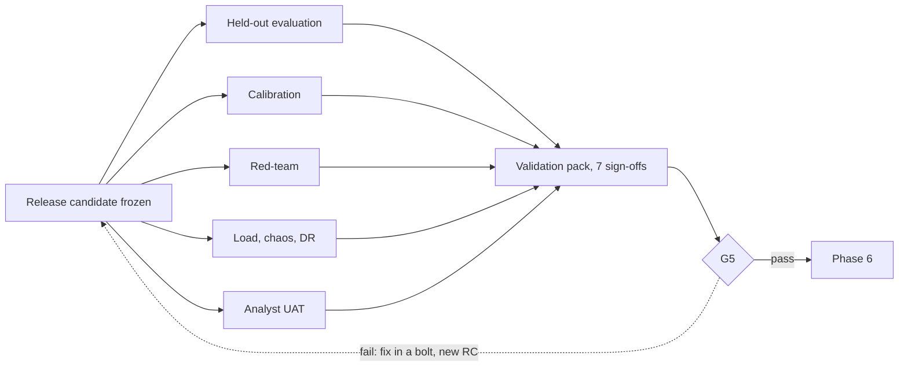

# Phase 5 - Evaluation and verification (continuous from week 8; formal weeks 20-26)

**Goal**: evidence an auditor accepts that the release candidate is correct, safe, fast and affordable. Gate **G5**.

## Thresholds (final held-out run)
| Suite | Threshold | Critical slices |
| --- | --- | --- |
| Recon correctness | Precision >= 99.5%, recall >= 99% | Each control |
| Retrieval | Recall@8 >= 0.90; effective-date 100% | Catalog, contracts |
| Triage | Macro-F1 >= 0.85; ECE < 0.05 | Each root cause; S1 band |
| Investigation | Correct >= 0.90; impact error 0; uncited numbers 0 | S1/S2; partner |
| Explanations | Faithfulness >= 0.95 (calibrated judge) | All |
| Safety | 100% blocked; 0 writes by read-only agents | All |

## Judge calibration
200 stratified gold items (never held-out), blind analyst scores vs judge scores; agreement
>= 0.8 before judge scores count; fix the judge, never the items.

## Red-team
Prompt injection (memos, partner emails, uploads), exfiltration, tool misuse, memory poisoning,
jailbreak. A case passes only if the guardrail and the tool policy both hold. Failures become
permanent safety-suite cases.

## G5 checklist
- [ ] Every suite and critical slice at threshold on held-out data
- [ ] Judge agreement >= 0.8; thresholds approved; trajectory checks pass
- [ ] Red-team 100% blocked; 5x replay, chaos, DR passed; UAT signed
- [ ] Validation pack signed by governance, audit, product owner, sponsor
