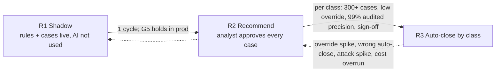

# Phase 6 - Release and go-live (weeks 24-32)

**Goal**: live in three releases of increasing autonomy, then hypercare. Gate **G6** after two clean billing cycles.

## Kill switches (AppConfig)
| Flag | Effect when off |
| --- | --- |
| `ai.triage.enabled` | Exceptions go straight to analysts |
| `ai.investigation.enabled` | Triage only |
| `autoclose.<class>.<band>` | Class returns to recommend |
| `ai.assistant.enabled` | Assistant hidden |
| `posting.live` | Posting back to dry-run |

## Release-day sequence
Change ticket -> deploy by digest -> AI flags = shadow -> production smoke test with trace ->
dashboards green -> 15-minute go/no-go -> first production bill run -> day-1 report.

## G6 checklist
- [ ] Two consecutive cycles within SLOs; no Sev1 in the last cycle
- [ ] Override rate and audited precision on target per class
- [ ] Cost per case within budget; KPIs measured against the Phase 0 baseline
- [ ] Autonomy register current; operations accepts on-call and runbooks
