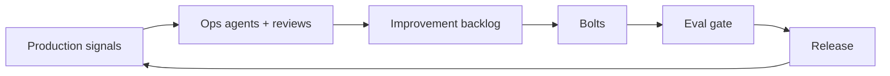
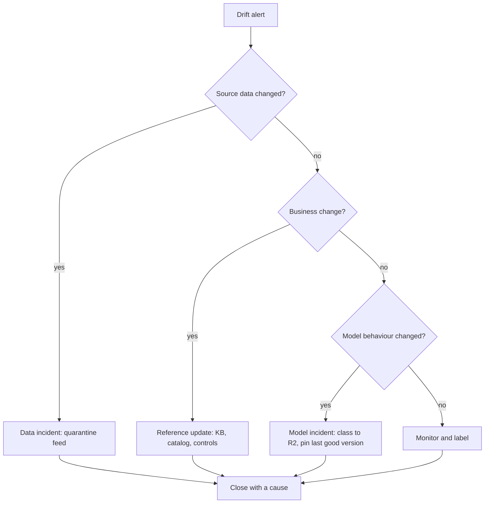

# Phase 7 - Operations and continuous improvement (week 28+)

## Rhythm
| Cadence | Activity |
| --- | --- |
| Daily | AgentOps digest (ops-analyst) and 20-minute review |
| Weekly | Auto-close audit; override mining; backlog grooming |
| Monthly | Drift review; cost review; value report |
| Quarterly | Gold-set refresh; model upgrade in shadow; model risk review; DR test; access review |

## Drift response

## Model and prompt upgrades
New version -> offline eval (every slice equal or better) -> shadow 5% for 7 days -> agrees with
analysts -> canary 10/50/100% via AppConfig -> pin and record (manifest, validation pack, ADR).

## Ongoing governance (quarterly)
- [ ] Autonomy register current; weekly audits >= 99% precision per class
- [ ] Gold set refreshed with a newest-quarter held-out slice
- [ ] Drift alerts closed with causes; DR test passed; access review done
- [ ] Cost per case within budget; value report signed by finance
