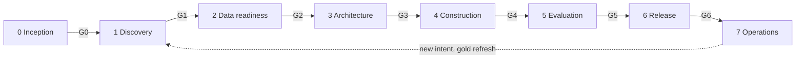

# Agentic SDLC

Backbone: AWS AI-Driven Development Lifecycle (Inception, Construction, Operations; mob
elaboration, mob construction, bolts), expanded into eight phases with explicit gates for a
regulated, data-heavy, multi-agent system. Delivery agents run in Claude Code.

## Principles
1. Intent -> spec -> code: specs in the repo are the source of truth.
2. AI proposes, humans decide: named owners approve every requirement, decision, merge and release.
3. Evals before agents: the gold set and eval harness exist before the first product agent.
4. Persistent context: CLAUDE.md, specs, ADRs, glossary and contracts carry across phases.
5. Traceability from intent to production.
6. Guardrails on delivery agents too: sandboxes, PRs only, no production credentials.

## Team
| Role | Count |
| --- | --- |
| Sponsor, product owner | 1 each |
| RA domain experts / analysts | 2-3 part-time |
| Solution architect | 1 |
| Data engineers | 2-3 |
| AI/ML engineers | 2 |
| Platform / SRE | 1-2 |
| QA / eval engineer | 1 |
| Security and AI governance lead | 0.5 |
