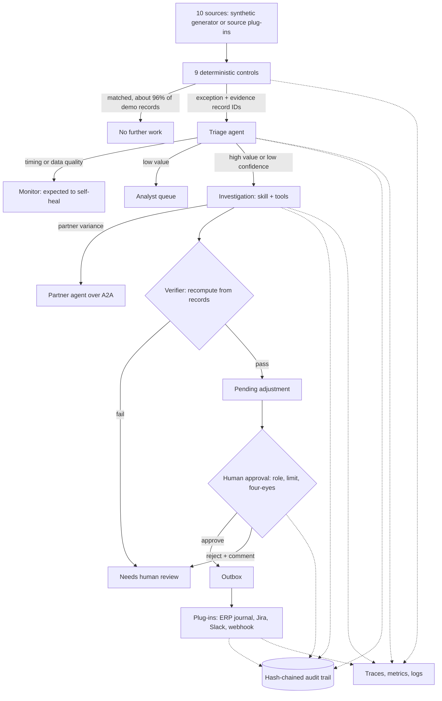

# Product guide

The product in `src/ra` runs end to end on one machine with no cloud account, and deploys as
a container. This guide covers what it does and how each part works.

| Topic | Read |
| --- | --- |
| Run it in five minutes | [quickstart.md](quickstart.md) |
| Sign-in, roles, policy rules | [security.md](security.md) |
| Tools, skills and the agent tier | [agents-tools-skills.md](agents-tools-skills.md) |
| MCP server and A2A integration | [mcp-a2a.md](mcp-a2a.md) |
| Plug-ins for external systems | [../../plugins/README.md](../../plugins/README.md) |
| Audit trail | [auditing.md](auditing.md) |
| Traces, metrics, logs, alerts | [observability.md](observability.md) |
| Before/after reporting | [reporting.md](reporting.md) |
| HTTP API reference | [api.md](api.md) |
| From this build to AWS production | [deployment.md](deployment.md) |

## How a run flows

## What is real and what is a stand-in

| Part | In this build | In production |
| --- | --- | --- |
| Controls, workflow, policy, audit, plug-in outbox, MCP, A2A, reporting | Real, tested | Same code |
| Data | Synthetic generator with injected faults | Source plug-ins or the lakehouse pipeline |
| Model | Offline rule-based reasoner (default) | Amazon Bedrock via `RA_LLM_MODE=bedrock` (not exercised by the test suite) |
| Identity | Built-in provider | Your OIDC provider via `RA_OIDC_ISSUER` |
| Storage | SQLite file | PostgreSQL/Aurora; audit copy to S3 Object Lock |
| Partner agent | Bundled mock | The partner's own A2A agent |
| External connectors | Dry-run by default | Switch `dry_run: false` after testing against your instance |

Triage accuracy on the synthetic data is close to 100% because the offline reasoner and the
fault generator share one fault catalogue. That number says nothing about real data; use the
gold-set evaluation in `docs/asdlc/05-evaluation.md` for that.
