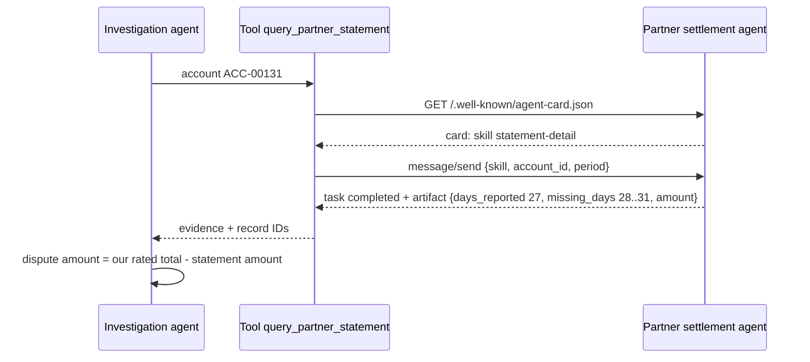

# MCP server and A2A integration

## MCP: tools for clients and other agents

The tool registry is served over the Model Context Protocol.

| Transport | Where | Auth |
| --- | --- | --- |
| Streamable HTTP | `POST /mcp/` on the API | Bearer token with `mcp:invoke`, plus each tool's own permission |
| stdio | `python -m ra.mcp_server` | `RA_MCP_TOKEN` environment variable |

```bash
# get a machine token (the secret is printed once by `ra seed`)
TOKEN=$(curl -s -X POST localhost:8080/auth/token -d grant_type=client_credentials \
  -d client_id=mcp-client -d client_secret="$MCP_SECRET" | jq -r .access_token)

curl -s localhost:8080/mcp/ -H "Authorization: Bearer $TOKEN" \
  -H 'Content-Type: application/json' -H 'Accept: application/json, text/event-stream' \
  -d '{"jsonrpc":"2.0","id":1,"method":"tools/list"}'
```

Client configuration (Claude Code `.mcp.json`):

```json
{"mcpServers": {"revenue-assurance": {
  "type": "http", "url": "http://localhost:8080/mcp/",
  "headers": {"Authorization": "Bearer ${RA_MCP_TOKEN}"}}}}
```

The `integration` role is read-only: `propose_adjustment` is listed but refused by policy.
Built on the official Python SDK, 2.x line.

## A2A: agent to agent

Version 0.3 of the protocol, JSON-RPC binding. Used in two directions.

**Outbound (where it is needed).** A partner settlement variance cannot be resolved from our
own data: the partner holds the other half. The `investigate-partner-variance` skill calls the
partner's agent through `query_partner_statement`, sends only the account, period and skill
name, and receives the days reported and statement total. The call is traced and audited with
the list of fields shared.



Set `RA_PARTNER_A2A_URL` and `RA_PARTNER_A2A_TOKEN` for a real partner. Without them the
bundled mock partner (`ra.a2a.mock_partner`) is used in-process.

**Inbound.** Other agents discover this product at `/.well-known/agent-card.json` and call
`POST /a2a`.

| Skill | Permission needed | Returns |
| --- | --- | --- |
| `explain-exception` | `exceptions:read` | Cause, variance, evidence IDs, case findings |
| `run-summary` | `reports:read` | Before/after report for the latest run |
| `investigate-exception` | `cases:work` | Case, verification, pending adjustment |

Callers also need `a2a:invoke`. Supported methods: `message/send`, `tasks/get`,
`tasks/cancel` (always refused: tasks finish within the call). Not implemented: streaming,
push notifications, and the 1.0 operation names; a request with `A2A-Version: 1.0` gets a
clear error.
