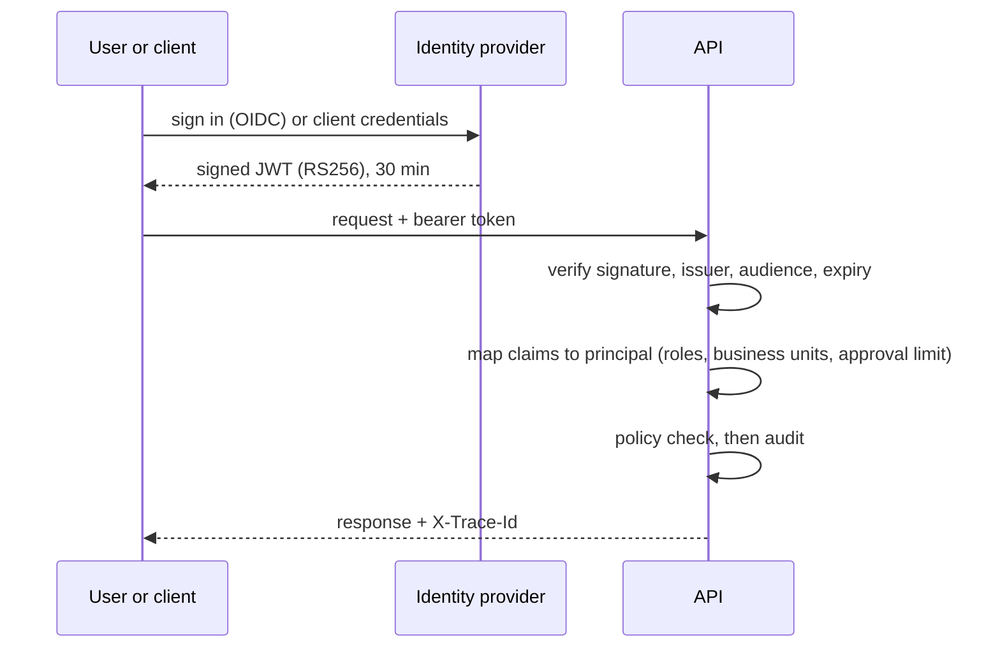

# Authentication and authorization

## Authentication: who is calling

Every request except `/healthz`, `/readyz`, `/metrics`, the agent card, the JWKS and the token
endpoint needs `Authorization: Bearer <JWT>`.

| Mode | How | Use for |
| --- | --- | --- |
| External OIDC | Set `RA_OIDC_ISSUER`, `RA_OIDC_AUDIENCE`, and if needed `RA_OIDC_JWKS_URL` and `RA_OIDC_ROLES_CLAIM`. Keys come from the provider's JWKS. Works with Amazon Cognito, Microsoft Entra ID, Okta, Keycloak. The built-in token endpoint is switched off. | Production |
| Built-in provider | `POST /auth/token` with the `password` or `client_credentials` grant. scrypt-hashed secrets, lockout after 5 failures for 5 minutes, 20 attempts a minute per address, identical error for every failure cause. | Local, demo, tests |

Claims read from an external token: roles from the configured claim (falls back to
`cognito:groups`, `groups`); `bu_scope` and `approval_limit` (also as `custom:` attributes).
The external path is implemented but has not been tested against a live provider.

## Principals

| Kind | Example | Notes |
| --- | --- | --- |
| user | `alice.analyst` | Human, signs in interactively |
| service | `mcp-client` | Machine client, client-credentials grant |
| agent | `agent:ra-runtime` | The AI tier's own identity. It never borrows the identity of the person who started the work |

## Authorization: what they may do

Default deny. A role grants permissions; attribute rules then narrow them.

| Role | Permissions |
| --- | --- |
| viewer | read exceptions, cases, reports |
| analyst | viewer + work cases, propose adjustments, call read tools |
| approver | read + approve or reject adjustments |
| auditor | read everything + audit trail, chain verification, traces |
| operator | start runs, plug-ins, traces |
| integration | read tools over MCP, call A2A skills |
| agent | read, work cases, call tools, propose, call partner agents |
| admin | everything |

Attribute rules, in `src/ra/auth/policy.py`:

1. **Business unit**: a principal sees only exceptions, cases, adjustments and tool results
   for business units in its scope.
2. **Approval limit**: an approver cannot approve an amount above their limit.
3. **Four-eyes**: nobody approves their own proposal, admins included.
4. **Human-only**: approval and user administration are refused for any non-human principal,
   whatever roles it holds. An agent cannot approve what an agent proposed.

Every denial is audited with its reason. Every allow on a state-changing action is audited.

## Other controls

- Tokens live in page memory in the console, never in browser storage.
- Response headers: `nosniff`, `X-Frame-Options: DENY`, `no-store`, CSP on the console.
- The MCP endpoint accepts only the configured host names (DNS-rebinding protection).
- Secrets for plug-ins and Bedrock come from the environment; config holds variable names only.
- Ground-truth labels in synthetic data never leave the API or reach a model prompt.
- The container runs as a non-root user with one writable volume.

Before production: put the API behind TLS and a WAF, use the external identity provider,
move rate limiting to the gateway, and keep the signing key in a KMS if you keep the built-in
provider for machine clients.
